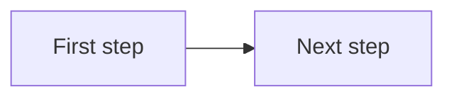

<!-- Save as a lowercase-kebab-case filename; the filename determines the URL slug. -->

> **TL;DR:** [One sentence. What is the point of this post?]

[Hook -- 1-2 sentences that earn the read.]

## [First section heading]

[Body]

## [Second section heading]

[Body]

<!-- Optional diagram: explain it in prose, then use accTitle/accDescr. It renders at natural size with scrolling, opt-in Pan mode, and a full-size viewer; colors follow the site's light, dark, and OLED themes. -->
<!--

-->

<!-- VS Code snippets: mermaid-flowchart and mermaid-sequence. Keep the fence in source; failed or disabled rendering leaves it readable. -->

---

*[Landing point -- a question, a next step, or what you are still chewing on.]*