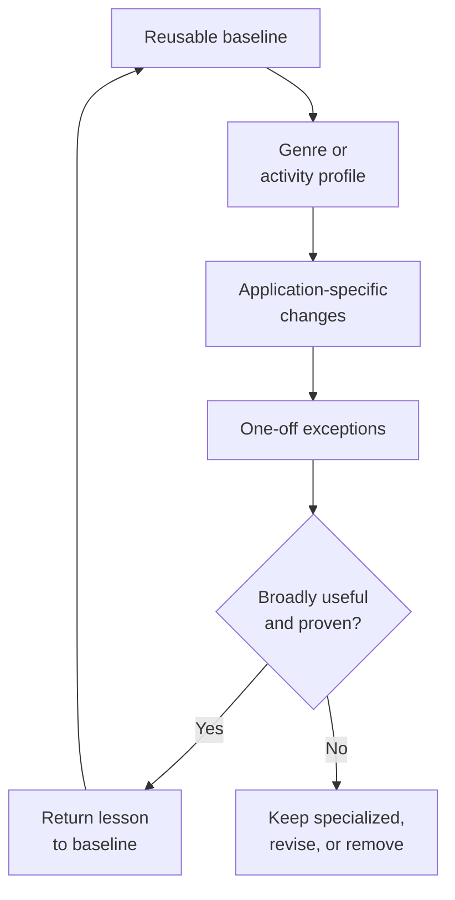

> **TL;DR:** A baseline gives us a dependable place to start; profiles and exceptions let it adapt, and experience helps decide which discoveries belong in the shared pattern.

*Part 4 of Personalizing Your Input Layer, a series about arranging controls around how we work and play.*

A mouse mapping that works well in one game may be useful precisely because it responds to that game's particular controls. It does not automatically need a place in every profile. Keeping it specific can make the game easier to play while preserving a simpler starting point for everything else.

A **baseline** is that starting point: a set of controls that stays useful within an intended scope. An **activity or genre profile** adapts it for a recurring kind of work or play. An **application-specific change** responds to one program, and a **one-off exception** handles a need that does not fit the shared pattern. These are useful ways to think about a setup; an individual device may organize them differently, and a workflow can move between them without following a fixed ladder.

Shared structure gives us familiar places to start and fewer choices to rebuild each time. Exceptions give us room to solve a particular problem without adding it to every context. That boundary can protect a baseline from sprawl.

---

My SliceMK keyboard's ZMK keymap provides a stable foundation for typing, navigation, and access to utility layers. Its FPS Gaming layer is a deliberate adaptation for an activity: it restricts access to the Mouse, Symbol, and Numpad layers while keeping an explicit way back to Main. The keyboard layers are part of the keymap; they are not selected by application focus. They provide a consistent base alongside more contextual controls on other devices.

On the Swiftpoint mouse, the Global profile establishes general behavior such as ordinary mouse controls, profile navigation, and feedback. The Tarkov, Siege, and BF6 configurations share a recognizable FPS-family structure, with specialized changes where a game calls for them. Tarkov adds its own equipment and other actions; Enshrouded uses a different combination for item selection, aiming, dodge, map, and inventory. The Notion profile serves another context altogether, with a small set of frequent block actions.

---

A template can also be a maintained convention. My Stream Deck's `ds fault` profile is the default workspace, with pages, folders, and routes to other profiles. Page and profile navigation, communications, and audio controls recur across selected layouts. I manually maintain these familiar controls so I can navigate among profiles and layers, including those I have not set up for focus switching. Focus-switched profiles may also retain navigation controls, with exceptions where a particular layout calls for them.

Application focus can bring the relevant layout forward. In the selected setup, Discord, Zoom, Escape from Tarkov, and Rainbow Six Siege have focus-activated Stream Deck profiles. A meeting profile can surface meeting controls; a game-focused profile can sit alongside communication and other shared utilities. The fact that a control appears in an application's profile does not by itself make it an action for that application. Keeping routes to pages and profiles available helps the workspace remain navigable as context changes.

Focus is useful context, but it is still worth knowing where to go when the desired profile is not on screen. Stable navigation and a recognizable default workspace make it easier to return to familiar controls. Versioned keymaps and profile exports help recover a known configuration after an unwanted change.

---

When I build and distribute customizations, I like to keep the following flow in mind. A useful exception can stay specific, be revised, or be removed. If a lesson proves useful across the contexts a baseline serves, I can bring it back into the shared pattern.

| Configuration level | Intended scope | Example in my setup | What remains shared | Promotion or exception | Failure or recovery consideration |
| --- | --- | --- | --- | --- | --- |
| Baseline | General use within its scope | Swiftpoint Global profile | Ordinary mouse and profile controls | Keep broadly useful controls understandable. | Keep a versioned export of the working profile. |
| Activity | A recurring class of activity | SliceMK FPS Gaming layer | The keyboard's keymap and explicit return path | Restrict utility-layer access for this context. | Return to Main when the activity ends. |
| Genre family | Related games | Swiftpoint Tarkov, Siege, and BF6 profiles | A recognizable control structure | Keep game-specific changes where they are needed. | Check that shared controls still mean what I expect. |
| Application | One program alongside shared tools | Zoom Stream Deck profile | Page/profile navigation and audio controls | Add meeting controls without rebuilding the whole workspace. | Navigate to another profile if focus selects the wrong context. |
| One-off | A distinct application's needs | Enshrouded mouse profile | The broader idea of a familiar input setup | Keep its distinct controls specific rather than spreading them. | Preserve the profile and its documented choices. |

---

After using a specialized mapping, I can ask whether the same idea recurs elsewhere and keeps the same meaning. Is its location or gesture predictable? Does it provide useful feedback? Will adding it make other contexts easier to maintain, or will it introduce another exception? A discovery that answers those questions well can be tried in the shared pattern. A mapping tied to one application's vocabulary or behavior may be better left where it is. If a control is unused, confusing, or superseded, revising or removing it can be the better lesson.

*Start with a dependable pattern, adapt it where the work calls for it, and bring back only the changes that earn a wider home.*
