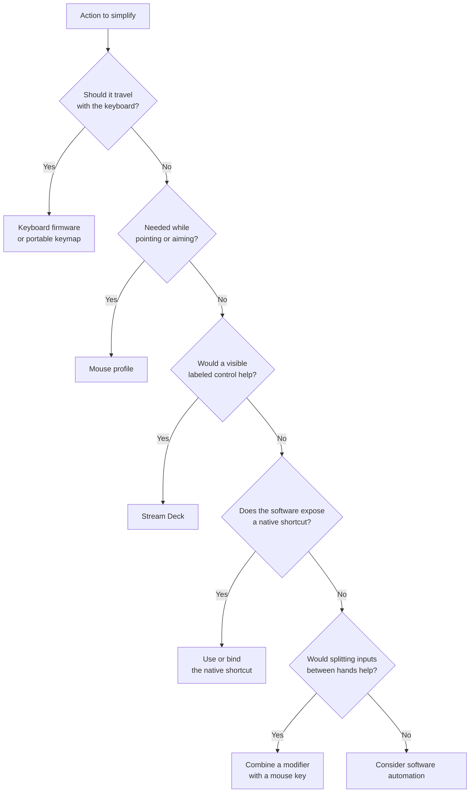

> **TL;DR:** Give an action the simplest dependable home that fits its context, and combine controls when that makes the interaction easier to understand and use.

*Part 2 of Personalizing Your Input Layer, a series about arranging controls around how we work and play.*

Suppose we often need to insert a particular block into a note. We could type the application's command, invoke a shortcut, assign an action to the mouse, or put a labeled button on a Stream Deck. Each could lead to the same result. The useful choice depends on where our hands are, how often we need it, and what will help us remember it later.

I think of this as choosing the **lowest sensible layer**: start with a dependable way to express the action that has as few unnecessary dependencies as possible, then consider what the surrounding workflow needs. “Lowest” is a practical preference, not a fixed ranking of devices. A control that travels with a keyboard may be a good fit for a common navigation action; a visible button may be easier to find for an infrequent one. Feedback, error cost, maintenance, and recovery can change the answer.

---

Some behavior is useful in many applications and benefits from staying with the keyboard. My SliceMK keymap uses ZMK firmware for typing, navigation, thumb controls, and access to symbol and numpad layers. The keyboard is the lowest-level building block in my setup: its keymap provides the foundation on which more contextual controls can build.

Application-specific actions can use the application's default shortcuts directly from the keyboard, or those same shortcuts can be mapped to controls in a mouse or Stream Deck profile. A single control can also run a sequence of shortcut actions. ZMK keymaps can include macros too; so far, I am more likely to put single- or multi-step macros in a mouse or Stream Deck profile, where I can organize them around the application or activity.

The mouse is a useful candidate when the right hand is already occupied with pointing or aiming. I also use mouse controls for key combinations that would otherwise require moving that hand to the keyboard, or asking the left hand to reach or hold too many keys. That can be useful for software commands as well as game controls. My Swiftpoint profiles use controls that can respond to presses, releases, force, and tilt; haptic feedback can signal a deeper press. The exported Notion profile includes a fingertip action that enters a frequent block command, placing it under the hand already working with the page.

Sometimes the answer is a combination. In my own use, the mouse can emit a base key while the other hand holds a keyboard modifier. The same base key can serve related actions with different modifiers, while splitting the input across hands leaves more fingers available on the keyboard. In a game such as Tarkov, that can make it easier to keep moving while carrying out another action, such as diagnosing and addressing a weapon malfunction. Keeping the relationship between the base action and its modified forms memorable helps the combination become a habit.

---

Visibility can matter more than reach. A Stream Deck profile can group labeled controls in folders and pages, giving occasional actions a recognizable place. My default workspace, `ds fault`, provides navigation among pages and profiles. Selected application profiles appear when their applications have focus, while routes to shared controls remain available. Encoders can support traversal or continuous adjustments where a repeated turn makes sense.

The application's default shortcut is often a useful starting point. If it reliably does what we need, we can use it directly or bind it to a keyboard key, a mouse control, or a Stream Deck button. Keeping the application's default means there is one less setting to change and maintain: we avoid having to update both the application binding and the device mapping, reducing opportunities for them to drift apart. It can also make Stream Deck buttons easier to share because they depend less on a customized application setup. Some workflows still need a changed binding, so this is a preference to consider rather than a requirement. A visible button invoking a native shortcut is another deliberate combination: the device supplies a convenient interface and the application defines the action.

An integration has more to offer when it supplies meaningful state or capabilities that a simple hotkey cannot. In my Stream Deck workspace, communication integrations can expose application state alongside controls, while native hotkeys handle many straightforward actions. Each added dependency is another thing to update and another possible point of failure, so the extra value should be clear.

---

This decision tree sketches the rough questions I keep in mind when giving a binding an initial home. We can start at whichever question fits, revisit a choice, or combine answers. Frequency, visibility, feedback, and the cost of an accidental action may lead to a different placement than the first branch suggests.

If the available device controls and application shortcuts cannot express an interaction reliably, software automation such as AutoHotkey is a possible later step. It can introduce its own dependencies, security considerations, maintenance, and recovery work.

Feedback can make a mapping easier to use: a haptic cue can signal a deeper press, and a visible control can help identify the current context. Where a device mapping uses an unchanged application shortcut, the original binding remains available. Some workflows need custom bindings, which are useful to document alongside the device mapping. Versioning keymaps and profile exports helps preserve known-good configurations and makes it easier to restore them after a change or failure.

---

When placing the next action, these are the rough guidelines I use to find an initial fit. They are prompts to consider, and a binding can move as the workflow evolves:

- **Context and frequency:** Where are my hands, which application is active, and how often will I use it?
- **Portability and visibility:** Should it travel with the keyboard, or would a labeled control help us find it?
- **Existing interfaces and combinations:** Is there a dependable native shortcut? Would two surfaces make the action easier to perform or remember?
- **Feedback and recovery:** Would haptics or a visible control help? Are the relevant bindings and versioned configurations documented and recoverable?
- **Maintenance:** Which choice will remain understandable and manageable as the workflow changes?

*Choose a starting point, use it in the real workflow, and adjust when experience reveals a better fit.*
