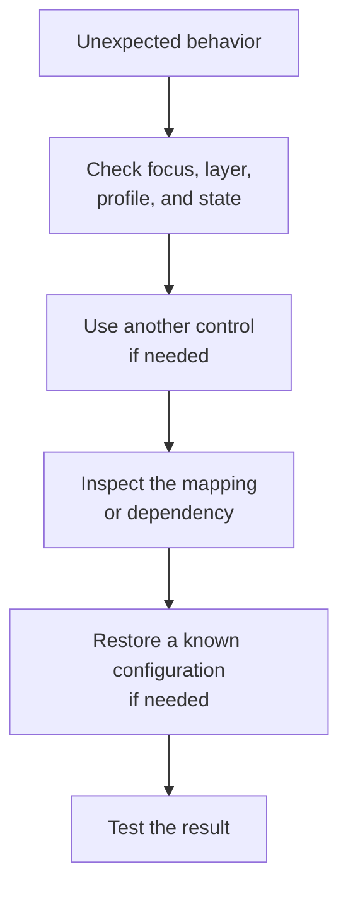

> **TL;DR:** Useful feedback helps identify the current state, a fallback keeps an action available, and a recovery path helps restore a known-good setup.

*Part 5 of Personalizing Your Input Layer, a series about arranging controls around how we work and play.*

Suppose a familiar button produces an unexpected action. The application may have focus in a different window, the active profile may have changed, or the mapping may no longer say what we think it says. Before changing the setup, it helps to pause and find out which context we are actually using.

I think of three related questions. **Feedback** helps me understand the state or the input that was registered. A **fallback** gives me another way to perform an action while a personalized control is unavailable. **Recovery** gets the affected setup back to a known-good state. A vibration, a native shortcut, and a saved configuration each answer a different question.

---

Haptic cues on the Swiftpoint can indicate a deeper press, and its OLED can provide profile information. The Stream Deck can show labels and state from supported integrations. A useful cue helps answer a particular question: which profile am I using, or did I reach the deeper press? Keeping labels aligned with their configured outputs makes those cues more trustworthy.

---

Things can go wrong in different ways: focus may select an unexpected profile, a release event could be missed, a force or tilt gesture could misfire, or a plugin or path could become unavailable. These are possibilities to recognize, rather than incidents I am claiming have occurred. If a Stream Deck button invokes an unchanged native shortcut, that shortcut is still available on the keyboard. Another input device or the application's own controls can also help while I check a profile or connection.

I use version control where I can to keep a history of configurations. For Stream Deck, I also export profiles and reusable buttons, macros, and folders. Those exports give me building blocks I can import into other profiles as well as a way to restore a known setup. That makes recovery and reuse part of the same practice: keep what works, make changes, and retain a way back.

The following is a loose starting point when something behaves unexpectedly. The path depends on what is available and what needs attention.

These examples show how feedback, an available alternative, and saved configurations can help in different situations.

| Situation | Useful feedback | Alternative | What I can check or restore |
| --- | --- | --- | --- |
| Unexpected profile | A visible label or profile indicator | Native controls or available profile navigation | Focus and the intended profile. |
| Unexpected force or tilt | Haptic or profile feedback where configured | An ordinary control or another binding | The mapping and gesture settings. |
| Plugin or path unavailable | Missing or stale state | A native shortcut or application control | The dependency and a known-good configuration. |
| Configuration changed | A label or output differs from what I expect | Another input surface | Version history or an exported profile or building block. |

---

When something behaves unexpectedly, I start with the context and the mapping. If I need another way to act, the native interface or another device may already provide one. Then I can inspect what changed, use version history or an export if needed, and return to the task.

The next place I want to start is the keyboard beneath it all: how the split layout, thumb clusters, and ZMK layers give my hands a familiar place to work. From there, I want to explore how the Swiftpoint adds actions under the mouse hand and how the Stream Deck brings visible controls into the current context. Each adds its own possibilities, and together they leave room for the input layer to keep evolving as the work does.
