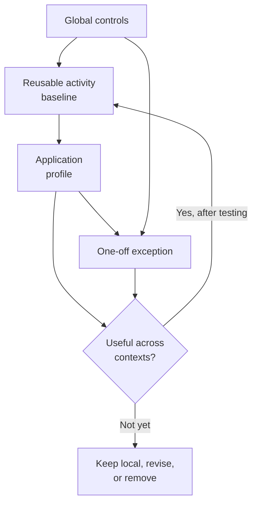

> **TL;DR:** A familiar starting point and shared patterns can make mouse profiles easier to build, maintain, and remember as activities change.

*Part 2 of Building High-Density Mouse Profiles with Swiftpoint, a series about shaping mouse controls around the work and play already happening under my hand.*

Every profile is a chance to distribute inputs in a way that better fits the activity. Starting with a similar profile can save effort when making and maintaining those changes, and familiar patterns make it easier to return to a game or application after time away. Clear labels in the configuration software help with that return too: they give us a way to look up what a control does while the habits come back.

My Global profile is the base: ordinary mouse behavior, scrolling, profile navigation, and the DPI presets I use across computer use. An **activity baseline** is a familiar pattern for a kind of work or play. An **application profile** can start from that pattern when a good fit exists, with **one-off exceptions** for its particular needs. Often a profile starts as a one-off; once enough similar applications or games share a pattern worth keeping, I can organize them into a family or folder and maintain a baseline for that group. Those layers of organization have grown out of starting with a similar profile and adjusting it over time.

---

Tarkov, Siege, and BF6 give me an example of a family built around shared FPS habits. Tilt, edge controls, thumb controls, triggers, and force regions all give the mouse hand places to contribute while the other hand stays near movement and modifiers. The front edge selects DPI, and the rear edge sends a keyboard key across those profiles. Familiar locations give the hand a place to start when moving between games.

The individual games still ask for different actions and combinations. Tarkov has its own equipment and other controls; Siege and BF6 have their own bindings. A family can share enough habits and control roles to make a common starting point worthwhile while leaving each game room to differ. Keeping that shared starting point together makes it easier to update when a pattern improves.

Notion is an example of a one-off productivity profile. Its page actions and shortcuts belong to a different workflow, so I keep a small set under the mouse hand, including actions that would otherwise take several inputs or a trip through menus. Other creation and knowledge-work applications often need their own arrangements for the same reason. Enshrouded has a different mix again, including scroll-based switching and controls for its own activities.

| Role | Example | What stays familiar | What changes | When to share a lesson | When to keep it local | Way back |
| --- | --- | --- | --- | --- | --- | --- |
| Global/default | Ordinary mouse and profile controls | Pointing, scrolling, DPI and profile navigation | The active context | Keep a control broadly useful and recognizable. | Leave a one-application action in its profile. | Select the intended profile or use ordinary controls. |
| Activity baseline | Pattern shared by Tarkov, Siege, and BF6 | Edge controls, thumb controls, triggers, and tilt have recurring places | Individual outputs and game bindings | Reuse a role that works across related games. | Keep a binding tied to one game there. | Use the game's ordinary input. |
| Application profile | Notion | Ordinary mouse behavior | Frequent page actions | Consider a gesture elsewhere if it earns the same meaning. | Keep a Notion-specific command in Notion. | Use the normal keyboard or page controls. |
| One-off exception | Enshrouded's activity-specific controls | A familiar mouse surface | Actions and gestures for that game | Share only a pattern that also proves useful elsewhere. | Keep a game-specific action local. | Use the game's ordinary controls. |

---

As profiles grow, we can look for habits that repeat: a similar action, a familiar key, or a gesture that makes sense across related activities. When that pattern is useful in more than one place, it can become part of a shared starting point—or the beginning of a new family. A mapping earns that wider home through use: it should be memorable, comfortable to trigger, and compatible with the controls around it.

This diagram follows the way profiles can develop. Its arrows show a design process: start from Global, use an activity baseline when one fits, and bring back lessons that prove useful. A one-off can also be the starting point for a new family.

---

Before relying on a change, check the actual output as well as its label, then try it in the application. A press and release should behave as expected, a force or tilt gesture should respond deliberately, and an ordinary control should be available when needed. Clear labels make the configuration easier to revisit, while regular use reveals which choices feel natural.

An exported collection gives me a backup of my Swiftpoint profiles. For a larger change, I usually clone the profile and work on the copy, saving and testing as I go. Once I am happy with it, I rename the replacement and remove the old profile. That gives me room to experiment while keeping the familiar version available during the work.

*Familiar profiles give each hand a starting point. Next, I'll look at how the mouse and keyboard can meet in the middle of an action, sharing a base key and its modifiers between hands.*
