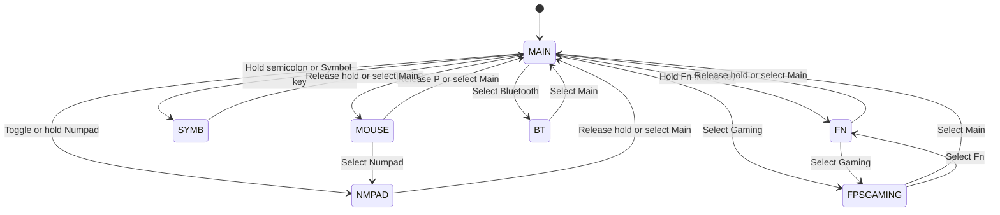

> **TL;DR:** Main is the foundation of my keyboard, and a few different kinds of layer access bring extra controls within reach when I need them.

*Part 2 of Building My Keyboard Layer with a SliceMK ErgoDox, a series about the keyboard foundation of my input setup.*

Most of the time my SliceMK starts with Main: a familiar typing layout with navigation and other frequently used keys near my thumbs. From there, a hold can bring up another set of controls for a moment, while a deliberate transition can move the keyboard into a different context. The layers work together, so I can add useful actions without putting every action on the same layout.

My current keymap uses ZMK and defines these seven layers in this order. The entry and return paths describe the bindings in this keymap; a temporary layer can sit over the layer beneath it.

| Number | Layer | Main role | Entry | Return | Useful controls |
| --- | --- | --- | --- | --- | --- |
| 0 | Main | Typing and navigation foundation | Explicit Main transitions from other layers | Starting point for other layers | Thumb navigation, modifiers, and layer controls |
| 1 | Numpad | Numeric entry | Left-side toggle, right-side hold, or explicit transition from Mouse | Release a momentary hold or use explicit Main | Keypad, operators, Home/End, media and volume |
| 2 | Mouse | Keyboard pointer and scrolling controls | Hold the `P` position | Release the hold or use explicit Main | Pointer movement, scrolling, function and media keys |
| 3 | Symbols | Symbols and navigation | Hold semicolon or either direct Symbol key | Release the hold or use explicit Main | Symbols, function keys, arrows, Home/End |
| 4 | FPS Gaming | Restricted gaming layout | Explicit transition from Main or Fn | Explicit Main or Fn transition | Letters, numbers, arrows, modifiers, thumb navigation |
| 5 | Fn | Function keys | Hold the Main thumb key or transition explicitly from Gaming | Release a momentary hold, or transition explicitly to Main or Gaming | Function keys and explicit transitions |
| 6 | Bluetooth | Connection and output controls | Explicit transition from Main | Explicit Main transition | Bluetooth profile selection, pairing clear, output toggle |

---

Two positions on Main do different work depending on how I use them. Tapping `P` types the letter; holding it exposes Mouse. Semicolon works the same way for Symbols. ZMK calls this a **layer-tap**: an ordinary key stays available for typing, and a hold gives the position another purpose. I also have two lower-row keys that bring up Symbols directly while held, plus a thumb key that momentarily brings up Fn.

Numpad has two paths from Main. The left-side control toggles it on for a longer run of numbers; the right-side control brings it up while held. For the momentary path, releasing the key ends the hold. In the current Numpad layout, an explicit Main control provides the return after using the toggle.

| Mechanism | Example | How I return |
| --- | --- | --- |
| Layer-tap | Hold `P` for Mouse; tap it for `P` | Release the hold, or use Mouse's explicit Main control |
| Momentary hold | Hold a direct Symbol key | Release the hold, or use Symbols' explicit Main control |
| Toggle | Toggle Numpad from Main | Use Numpad's explicit Main control |
| Explicit transition | Move from Gaming to Fn | Select an explicit Main or Gaming transition from Fn |

The difference matters when deciding how long I want another set of controls available. A brief hold suits an action in the middle of typing; a deliberate transition makes sense when I am changing context for longer. Gaming has explicit routes to Main and Fn, and Fn has explicit routes back to either. Bluetooth has its own deliberate entry and return. Mouse also has an explicit Numpad transition as well as a Main control.

---

This diagram is a conceptual view of those paths. Momentary layers can act as overlays, so the arrows should not be read as a claim that every layer is a mutually exclusive persistent state. Releasing a hold returns to the underlying layer behavior; explicit transitions select the indicated layer.

The layer layouts also make room for controls in different places. Main uses modifier-taps on the quote, slash, and equals positions, while Symbols places arrows along the lower right and Home and End near the thumbs. Gaming keeps a separate set of arrows and modifier positions. These placements give each context its own useful arrangement while the thumb navigation remains a familiar part of the keyboard.

---

*Next, I want to look more closely at how the Symbols and Numpad layers support the practical work of entering punctuation and numbers.*
