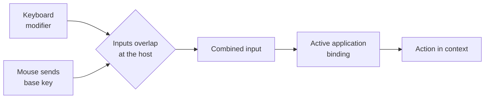

> **TL;DR:** A mouse can send a base key while the keyboard supplies a modifier, letting both hands contribute to a shortcut without moving the pointing hand away.

*Part 3 of Building High-Density Mouse Profiles with Swiftpoint, a series about shaping mouse controls around the work and play already happening under my hand.*

Some shortcuts ask one hand to reach farther than it wants to, or ask the other hand to leave the mouse at just the wrong moment. We can split the work: put a base key on a mouse control and hold a modifier on the keyboard. The right hand can keep pointing or aiming while the left stays near movement and familiar keys.

The devices each send ordinary inputs to the computer. When the modifier and base key overlap, the host receives both, and the active application interprets the combination according to its own bindings. The same input can mean different things in different applications, so the application's binding is part of the design.

---

In my Swiftpoint Tarkov profile, a rear-edge control sends `B`: pressing it sends the key down, and releasing it sends the key up. The ZMK keymap on my SliceMK gives my left hand access to Shift, Control, and Alt. Combining those modifiers with the mouse control gives me several weapon actions from the same base key. The mouse supplies `B`, my other hand supplies a modifier when needed, and the game responds to the resulting input.

A fingertip control in the same saved mouse profile sends a tap of `5`. That gives another action a place under the mouse hand. A tap is a complete key press and release; the rear-edge `B` mapping instead has separate down and up outputs tied to the mouse control's press and release. Both can be useful, depending on the action and how long its input needs to remain held.

| Mouse action | Keyboard modifier | Tarkov input | Action in my setup |
| --- | --- | --- | --- |
| Hold the rear-edge `B` control | None | Hold `B` | Inspect the weapon; release after the inspection animation to repair a malfunction. |
| Double-tap the rear-edge control | None | Double-tap `B` | Switch to full auto. |
| Press the rear-edge control | Shift | `Shift+B` | Cycle fire mode. |
| Press the rear-edge control | Alt | `Alt+B` | Toggle the bipod. |
| Press the rear-edge control | Control | `Control+B` | Check the ammunition or magazine load. |
| Press the rear-edge control | Control and Shift | `Control+Shift+B` | Toggle a folding stock. |

The bindings give one mouse control several related jobs. The keyboard modifiers extend what it can do, while the remaining fingers can stay available for movement and other actions. These are the actions I use in my Tarkov setup; another application or a different set of bindings can give the same inputs different meanings.

---

Sharing the combination between hands makes more of the available controls usable at once. The mouse hand can manage a weapon action while the keyboard hand continues to handle movement or another input. Grouping related actions around `B` also gives those combinations a common thread to remember, even though each game may need a different arrangement.

---

*A shared base key and familiar modifiers put more actions within reach while both hands stay involved in the game. Next, in “Press, Release, Light Press, and Deep Press,” I'll look at how different gestures on one mouse control can open up more input options.*
