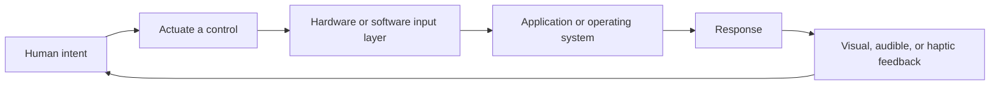

> **TL;DR:** Personalizing an input layer means placing understandable controls where they fit the way we work and play, with feedback and a way back when something goes wrong.

*Part 1 of Personalizing Your Input Layer, a series about arranging controls around how we work and play.*

When we want a computer to do something—insert a block into a note, change a setting, or move in a game—we express that intent by actuating a control. We might press a key, click a button, or select a visible action. The system responds, and we look, listen, or feel for feedback before deciding what to do next.

That loop is familiar enough to disappear into the background. But the route from intention to response can be shaped. A control can be nearby or awkward to reach; its meaning can be obvious or hard to remember. A response can be clear, or leave us wondering whether anything happened.

---

The *input layer* is the combination of hardware and software through which we tell a computer what we want: keys, buttons, keyboard firmware and layers, device profiles, shortcuts, menus, and visible controls. Actuation is the moment we use one of those controls. What happens afterward depends on how the input layer translates the action for an application or the operating system.

The loop includes the response as well as the control. Text appearing in a note is visual feedback. A sound can confirm an event; a vibration can signal that a pressure threshold was reached. Feedback informs our next action, including whether we need to try again or recover.

Defaults are general-purpose starting points. We can adjust them when a frequent action is difficult to reach, when a control would be more useful closer to the task, or when a visual reminder would help us remember what is available. In my own setup, I aim to reduce unnecessary movement and context switching where that helps the workflow. The benefit depends on the person, the task, and the cost of learning the arrangement.

---

On my SliceMK split keyboard, the ZMK firmware runs a keymap organized into seven layers. The main layer places frequently used controls on the thumb clusters and provides access to symbols, a numpad, and other functions. Some keys distinguish a tap from a hold, making another layer available without dedicating a separate key to every action. The gaming layer limits access to several utility layers and includes an explicit return to the main layer. Together, the keymap and its transitions give the keyboard a consistent foundation across applications.

Swiftpoint mouse profiles give the pointing hand another set of possibilities. A profile can distinguish a press from a release, light from deeper pressure, and tilt from a button press. Haptic feedback can help indicate a deeper action. In my Notion profile, a fingertip action enters a frequently used block command. It puts a contextual action near the hand already pointing at the page, while other controls remain available for ordinary mouse use.

The Stream Deck adds a different kind of surface: visible controls grouped into pages and folders within profiles. My default profile provides routes to other pages and profiles, and selected application profiles can appear when their applications have focus. Persistent navigation keeps those contexts connected to the rest of the workspace. A multi-slot clipboard folder illustrates the idea: visible slots and a clear action give a repeated workflow a place while keeping the contents private.

These surfaces complement one another. A keyboard keymap can provide a stable foundation, a mouse profile can put actions near pointing, and a Stream Deck profile can make less memorable choices visible. A native shortcut can be enough on its own. A more elaborate arrangement earns its place when we can understand what it does, recognize the current context, and get back to a known state.

---

Games make context especially clear. I use personal mappings to place actions within reach while playing, and the keyboard's restricted gaming layer keeps several utility layers out of the way. Each mapping gives an action I perform a familiar place in that context.

Adding actions also gives us something to learn, but a change does not have to feel unfamiliar for long. A control used often, placed where it makes sense, or connected to an action family we already know can become familiar through use. The more intuitive the arrangement, the less attention we have to spend recalling it while we work. That is part of the appeal of customization: putting thought into the setup so everyday actions can become more natural.

Clarity still matters as the arrangement grows. If a button means unrelated things in different contexts, or we cannot tell which keyboard layer or device profile is active, the saved movement may come at the cost of hesitation and mistakes. Stable navigation, feedback, manual fallbacks, and known-good keymaps and profiles help us keep a dense setup understandable. When a profile or integration fails, we still need a way to operate the computer and restore a working setup.

The useful questions are where an action makes sense, how we will recognize it, and what happens when the expected response does not arrive.

---

*Next, we will look at how to choose where an action should live. Planned peer series will go deeper into the SliceMK keymap, Swiftpoint profiles, and Stream Deck workspace; this series will connect the decisions across them.*
