> **TL;DR:** My FPS Gaming layer keeps the keys I use during play while setting aside the layer shortcuts that could interrupt it.

*Part 4 of Building My Keyboard Layer with a SliceMK ErgoDox, a series about the keyboard foundation of my input setup.*

While typing, an accidental layer hold is usually easy to notice and correct. In a game, discovering that a familiar control has changed in the middle of movement can be much more disruptive. My SliceMK's FPS Gaming layer gives me a steadier set of controls for that context, with a momentary Fn hold and a deliberate return to Main.

The ZMK keymap changes what several positions do when I enter FPS Gaming. The letters, numbers, and navigation I need remain available, while the shortcuts into Mouse, Symbols, and Numpad are set aside.

| Control | Main | FPS Gaming | Why it matters to me |
| --- | --- | --- | --- |
| `P` position | Tap `P`; hold for Mouse | Direct `P` | Holding the position will not bring up pointer controls. |
| Semicolon position | Tap semicolon; hold for Symbols | Direct semicolon | The key keeps its ordinary output during a hold. |
| Direct Symbols controls | Two lower-row momentary holds | No direct Symbols entry | Those positions cannot open the symbol layer during play. |
| Numpad controls | Left toggle and right momentary hold | Neither Numpad entry path is present | The keypad layout stays out of the gaming context. |
| Fn | Momentary thumb hold | Momentary Fn hold on the lower row | Fn stays available while I hold the key. |
| Navigation | Home, End, Page Up, and Page Down near the thumbs | Those thumb controls remain; arrows sit on the lower right | Movement and navigation remain within reach. |
| Print Screen | Fn hold at that thumb position | Direct Print Screen | I can capture a screen without entering Fn first. |
| Return to Main | Starting layer | Explicit thumb-cluster transition | I have a known way back when I finish playing. |

---

The layer-taps on `P` and semicolon are useful during ordinary work, but I want those positions to behave as keys throughout a hold in the gaming layer. The same reasoning applies to the direct Symbol holds and the two Numpad controls: I would rather keep utility layers out of the way while I am using the keyboard for a game.

An earlier version of this gaming layer exposed Numpad. In my current keymap that path is gone, along with the Main-layer toggle and momentary entry. If I need Numpad again, I can return to Main and choose it there.

The restricted layer still has letters and numbers, left Control and Shift, additional left Alt and Control positions on the lower row, and arrows on the right. The thumb cluster keeps Space, Backspace, Delete, Escape, Tab, Return, Home, End, Page Up, and Page Down nearby. It also gives Print Screen a direct position. These placements give my hands more options for combinations that could be awkward to reach on a conventional keyboard, while keeping fingers available for other controls. They reflect what works in my setup and may change as I use it.

---

Fn is still part of the gaming layout. On Main I hold a thumb key to use it temporarily; in FPS Gaming I hold a lower-row key for Fn and release it to return to Gaming. The thumb-cluster Main control provides a separate way back to the ordinary layout.

```mermaid
stateDiagram-v2
    accTitle: SliceMK gaming layer transitions
    accDescr: Main enters FPS Gaming explicitly. Holding the Gaming Fn key temporarily exposes Fn; releasing it returns to Gaming. Gaming has an explicit return to Main and no entry paths to Mouse, Symbols, or Numpad.

    [*] --> MAIN
    MAIN --> FPS: Select Gaming
    FPS --> FN: Hold Fn key
    FN --> FPS: Release Fn key
    FPS --> MAIN: Select Main
    note right of FPS
        No Mouse, Symbols, or Numpad entry
    end note
```

The note describes entry paths absent from the gaming keymap. The Fn hold is a temporary overlay; releasing it returns to Gaming. Fn also has its own explicit return to Main.

The keyboard is only one part of how I play. My left hand can stay with movement, modifiers, and nearby thumb controls while the mouse handles actions I want under my pointing hand. A keyboard modifier can also work with a base key sent by the mouse, letting both hands share a combination while other fingers stay available. I will explore the mouse profiles themselves in their own series.

---

*Choosing what the keyboard should handle also means deciding what belongs elsewhere. Next, I want to look at the boundary between firmware and the rest of my input setup.*
