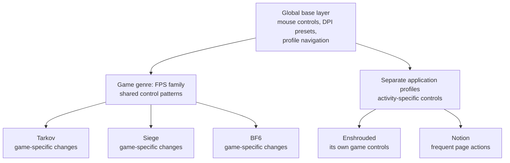

> **TL;DR:** My mouse keeps pointing and aiming under my right hand while giving that same hand useful actions to share with the keyboard.

*Part 1 of Building High-Density Mouse Profiles with Swiftpoint, a series about shaping mouse controls around the work and play already happening under my hand.*

When a task calls for pointing and a keyboard shortcut in quick succession, I can take my right hand off the mouse to reach the keys. If I do that often enough, the hand transfer becomes part of the task. Putting a useful action under the mouse hand lets me keep pointing while my left hand stays near typing, movement, modifiers, and the layers on my split keyboard.

I use Swiftpoint Z2 and Z3 mice with the same configuration platform. Their ordinary buttons still handle familiar mouse actions, while auxiliary controls give my fingers other places to work. A press can start an action and a release can end it. A deeper press or a tilt can make another action available from the same area of the mouse. Profiles let those controls serve different activities without needing every action at once.

---

The mouse and keyboard can also meet in the middle. In my use, one hand can hold a keyboard modifier while the mouse sends a base key. That lets me keep other fingers available on the keyboard while the pointing hand contributes to a combination.

| Control dimension | What my hand does | Capability | Role | Limit | When I need another route |
| --- | --- | --- | --- | --- | --- |
| Ordinary buttons | Press and release | Mouse-button down and up actions | Point, select, and use familiar controls | A held input needs a corresponding release. | Use the ordinary mouse controls or keyboard. |
| Auxiliary controls | Press a trigger, edge, or fingertip control | Additional button-triggered actions | Put a frequent action under the mouse hand. | Too many unrelated actions are harder to remember. | Use the application's usual control. |
| Force regions | Press lightly or more deeply | Separate light and deeper force regions | Give one location another deliberate action. | The regions need to be distinguishable in use. | Use a separate key or control. |
| Tilt | Roll or pitch the mouse | Directional and continuous tilt regions | Put navigation or a paired action near pointing. | A gesture can be activated by mistake. | Use the regular key or navigation control. |
| Feedback | Feel a cue if haptic is enabled | Haptic | Help recognize a deeper press. | A cue has to be understandable to be useful. | Use a familiar control. |
| DPI and profiles | Choose a global DPI preset or switch profiles | DPI selection and profile jumps | Adjust pointing across computer use or choose another set of actions. | The wrong profile can change what a control does. | Select the intended profile manually. |
| Application context | Use a profile associated with an application | Application associations on selected profiles | Bring relevant actions together for an activity. | The active profile needs to suit the task. | Switch profiles manually. |

These are ways to give my hand options, and each one takes practice. A control is most useful to me when I can remember what it does and trigger it deliberately. Actions I don't use often, or can already reach comfortably, stay on their usual keys.

---

I keep the Global profile minimal and useful wherever I am working or playing. It includes a single DPI adjustment control with a few presets I can choose from across computer use, alongside ordinary mouse controls and profile navigation.

When several applications ask for similar actions, I can build a family around that shared activity. Tarkov, Siege, and BF6 have enough FPS controls in common that I can carry a recognizable pattern between them, then adjust each profile for the game. A familiar gesture gives me a place to start; the individual profile makes room for differences that matter during play.

Other activities can have their own arrangements. Enshrouded calls for a different mix of game controls, while my Notion profile keeps a small set of frequent page actions close to the pointer. I can keep those choices specific to their applications and leave the Global profile focused on what is useful broadly.

I build these profiles around Global as the base layer. A genre family and a separate application profile are parallel ways to add context; the individual FPS profiles then make room for each game.

---

*A useful global starting point, familiar patterns across related activities, and room for exceptions let my mouse hand contribute without leaving the pointer. Next, I'll look at how I build that reusable starting point.*
